# Mike Perrella

**Cybersecurity · Governance, Risk & Compliance · Security Engineering · AI Security**

B.S. Computer Information Systems (Cybersecurity), Florida Gulf Coast University · **CompTIA Security+**

[LinkedIn](https://www.linkedin.com/in/mikeperrella/) · [GitHub](https://github.com/mikeperrella) · [BizAI Solutions](https://bizaisolutions.net/)

## About me

I build security and AI tools that solve practical problems. My work covers identity governance, compliance evidence, risk assessment, and security operations, with a focus on making automation verifiable and keeping people in control of important decisions.

I graduated from Florida Gulf Coast University in May 2026 with a B.S. in Computer Information Systems, concentrating in cybersecurity. Alongside my security projects, I founded BizAI Solutions to build applications, AI agents, and workflow automation for businesses.

## Selected projects

### [VIGCAP — Identity Governance & Continuous Assurance](https://github.com/mikeperrella/veridian-identity-governance)

`Python` `Streamlit` `n8n` `Docker` `CISO Assistant REST API`

Built an identity-governance and GRC program using synthetic organizational data. Scored **16 risks**, tested **10 controls** mapped to **12 SOC 2 CC6 requirements**, and automated an access review that auto-attested **29 accounts** while escalating **2 exceptions** for manual follow-up.

### ALIBI — Answers Linked to Immutable, Backed Information

`Rust` `Tauri` `Python` `FastAPI` `SQLite` `Ollama`

Designed a **local-first, air-gapped GRC workbench** for answering security questionnaires from an organization's own policies, with verbatim citation verification and human approval. Documented a **245-row STRIDE threat model**, **22 architecture decision records**, and **4,300+ automated tests**.

*Private repository — demo available on request.*

### [Aegis Triage — Agentic SOC Alert Triage](https://github.com/mikeperrella/aegis-triage)

`Python` `FastAPI` `LangGraph` `Claude API` `Next.js` `Docker`

Developed an agentic alert-triage pipeline with threat enrichment, prompt-injection guardrails, an append-only audit trail, and a human review requirement for automated verdicts. Tested the detection and guardrail behavior using defined evaluation sets.

### [ARGUS — Automated Rule Generation Under Supervision](https://github.com/mikeperrella/ARGUS)

`Python` `YARA / YARA-X` `MITRE ATT&CK` `Malware Analysis`

Explored supervised detection-rule generation and validation, including static malware analysis and a human-in-the-loop review process.

## What I work with

| Area | Tools and topics |
| :-- | :-- |
| **GRC & compliance** | SOC 2, NIST CSF 2.0, NIST 800-53, ISO 27001 mapping, risk assessments, control testing, audit evidence, access reviews, STRIDE |
| **Security engineering** | IAM, Okta, detection engineering, MITRE ATT&CK, YARA, threat analysis, vulnerability assessment, incident response support |
| **AI & software** | Python, Rust, TypeScript, React, Next.js, FastAPI, LangGraph, Ollama, local LLMs, agentic AI |
| **Automation & infrastructure** | Docker, SQLite, n8n, REST APIs, Terraform, Git, Cursor, Claude Code |

## Experience

- **Founder & CEO · [BizAI Solutions](https://bizaisolutions.net/) (2025–present)** — Building custom applications, AI agents, and business workflow automation with security-conscious design.
- **IT Intern · Covington & Burling LLP (summer 2024)** — Enterprise IT support, troubleshooting, system checks, and 20+ tickets per week.
- **Cybersecurity Associate Intern · International Flavors & Fragrances (summer 2023)** — Supported global InfoSec work including threat analysis, phishing investigations, security awareness, and identity lifecycle processes.

<h2>All-Time GitHub Commits</h2>

  

---

**Open to security, GRC, and AI engineering opportunities and collaboration.**

[Let's connect on LinkedIn](https://www.linkedin.com/in/mikeperrella/)

